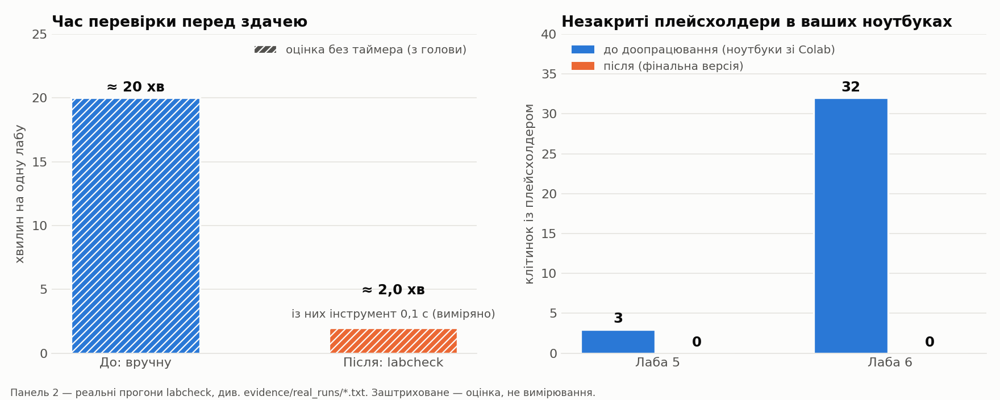
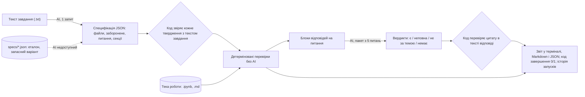

# МКР-1. Як я покращив життя за допомогою AI: `labcheck` — перевірка лабораторної перед здачею

**Автор:** Патлай Максим Васильович, ФІКТ, «інженерія програмного забезпечення», Житомирська політехніка. Курс «Системи штучного інтелекту», дедлайн МКР-1: 01.12.2026.

> **Про методику й чесність даних.** Код інструмента і чернетка цього звіту підготовлені за допомогою AI-асистента (Claude); запуск, перевірку й відповідальність за вміст бере на себе автор.
> Усі числа в таблицях підставив скрипт `solution/finalize_report.py` із логів у `evidence/`, вручну їх не набирали.
> Значення «до», яких я не міряв таймером, позначені словом **оцінка** (викладач дозволив оцінки без таймера); їх можна змінити у `solution/estimates.json` і перезібрати звіт.
> Усе, що позначено **виміряно**, відтворюється командами з `solution/README.md`.



## 1. Планування (заповнена таблиця з п. 0)

| Поле | Що написано |
|---|---|
| **Проблема** | Перед кожною здачею треба довести, що репозиторій відповідає тексту завдання: точні шляхи файлів (у лабі 6 і 5 «інакше не зарахується»), 30 відповідей на теоретичні питання в правильних ноутбуках, немає заготовок і секретів, немає вагів моделей та індексів. Найближчі здачі: лаба 5 (28.11), МКР-1 (01.12), лаба 6 (12.12) — три здачі за три тижні, і ця сама перевірка щоразу. |
| **Поточний процес** | 7 ручних кроків, ≈ 20 хв на одну здачу (**оцінка**): виписати вимоги з тексту → звірити імена й шляхи файлів → знайти заготовки (Ctrl+F у 4 ноутбуках) → переконатися, що клітинки запущені без помилок → пройти 30 питань (є заголовок і текст?) → шукати зайві файли та ключі (`git status`) → звірити секції звіту. |
| **Дані** | Текст завдання (`.txt`, 13–17 КБ) і тека з роботою: 4 ноутбуки `.ipynb` ≈ 3 МБ або `report.md`. Дані мої власні: ноутбуки з Colab і файли з репозиторію GitHub. |
| **Рівень рішення** | **1 — Prompt / AI API**: один запит до моделі на крок (розбір тексту завдання; оцінка пакета з 5 відповідей). Решту робить звичайний код. Обґрунтування — у розділі 4. |
| **Метрика успіху + ціль** | Час перевірки однієї здачі ≤ 5 хв (було ≈ 20 хв); знаходить ≥ 95% підкинутих дефектів і 0 зайвих спрацювань на чистому репозиторії; AI-суддя знаходить ≥ 90% підкинутих порожніх/чужих відповідей; вартість ≤ $0,01 за лабу. |
| **Ризики / fallback** | AI вигадує вимоги або каже «відповідь є» без підстав → код звіряє кожну цитату з текстом і не приймає непідтверджене; AI-знахідки лише попередження. AI/API недоступний → кеш, повтори, запасна специфікація `specs/*.json`, режим `--no-ai`. Повна таблиця — у розділі 6. |

**KPI: ціль і результат** (рядки з «не вимірювалось» заповнюються після AI-прогону `python demo_run.py`):

| KPI | Ціль | Результат | Досягнуто? | Тип значення |
|---|---|---|---|---|
| Час на перевірку однієї лаби | ≤ 5 хв | 2,2 хв | так | оцінка (читання виводу) + виміряно (інструмент, AI) |
| Знаходить підкинуті дефекти (recall) | ≥ 95% | 100% (85 із 85) | так | виміряно |
| Зайві спрацювання на чистому репозиторії | 0 | 0 | так | виміряно |
| AI-суддя знаходить підкинуті порожні/чужі відповіді | ≥ 90% | 100% | так | виміряно (AI-прогін) |
| Вартість перевірки однієї лаби | ≤ $0,01 | ≈ $0 | так | виміряно (токени) × тариф із `.env` |

## 2. Архітектура рішення



| Компонент (`solution/labcheck/`) | Що робить | Чи AI |
|---|---|---|
| `static_checks.py` | точні шляхи з урахуванням регістру, плейсхолдери, ключі й `.env`, заборонені вагові файли та індекси, розмір ≥ 100 МБ, помилки у виводах, не запущені клітинки, `widgets` без `state`, службові теки, секції звіту, довжина відео, розуміє `.gitignore` | ні |
| `notebook.py` | читає `.ipynb` і `.md` (UTF-8 і cp1251), знаходить заголовки «Питання N» і межі відповіді | ні |
| `ai_steps.py` → `extract_spec` | AI перетворює текст завдання на чекліст; `verify_spec` відкидає все, чого немає в тексті | так, рівень 1 |
| `ai_steps.py` → `judge_questions` | AI оцінює, чи блок відповіді стосується питання; вердикт без підтвердженої цитати не приймається | так, рівень 1 |
| `llm.py` | клієнт до будь-якого OpenAI-сумісного API на stdlib: повтори на 429/5xx, дисковий кеш, облік токенів і вартості | — |
| `bench.py`, `demo_run.py`, `finalize_report.py` | вимірювання якості, один запуск усіх AI-доказів, автозбірка звіту | — |

## 3. AI-технології та інструменти

- **Модель:** `gemini-3.5-flash-lite`. Виклики йдуть через OpenAI-сумісний `/chat/completions` (за замовчуванням Gemini, але підійде OpenRouter, Groq, Ollama, LM Studio: змінюються лише `LLM_BASE_URL` і `LLM_MODEL`). Температура 0, відповіді лише у форматі JSON; невалідний JSON → один повтор з нагадуванням.
- **Код:** Python 3, лише стандартна бібліотека (`urllib`, `json`, `difflib`, `re`). Жодних важких ML-залежностей: інструмент запускається на будь-якому ноутбуці без установки пакетів.
- **Тестування й вимірювання:** `pytest` (понад 40 тестів, зокрема справжній локальний HTTP-сервер для перевірки повторів, кешу й помилок авторизації), `matplotlib` лише для графіка, `ffprobe` за наявності — для перевірки довжини `demo.mp4` (60–90 с).

## 4. Обґрунтування вибору підходу (рівня AI-рішення)

| Питання з п. 3 завдання | Відповідь для моєї задачі | Висновок |
|---|---|---|
| Чи вистачає одного запиту? | Так: текст завдання — кілька тисяч токенів (точно — у таблиці 7.3), пакет із 5 відповідей — близько 14 тис. символів. | рівень 1 |
| Потрібні дані, яких немає «в голові» моделі? | Ні: усе потрібне (завдання й відповіді) я кладу в сам запит. | RAG не потрібен |
| Кроки залежать від попередніх і сценарій наперед не описати? | Ні: сценарій фіксований (розбір → перевірки → оцінка → звіт), кожен крок я знаю наперед. | агент не потрібен |
| Є десятки власних прикладів, і prompt систематично гірший? | Ні, прикладів для донавчання немає; спершу беру prompt із перевіркою цитат, а його якість міряю в розділі 7.3 (якби її не вистачило, наступним кроком були б RAG чи донавчання). | fine-tuning не потрібен |
| Задача не про текст, а про власну прогнозну модель? | Ні. | рівень 5 не потрібен |

**Чому взагалі AI, якщо більшість перевірок детермінована.** Для двох речей, які без AI не зробити так само універсально. Перша: прочитати довільний текст завдання й отримати чекліст, без ручного написання конфігурації для кожної лаби. Друга: оцінити, чи текст під заголовком відповідає саме на це питання, а не просто існує. Регулярні вирази це не вирішують, тому лише ці два кроки віддано моделі, а усе, що можна перевірити точно (шляхи, ключі, заготовки), перевіряє код.

**Розглянуті альтернативи:**

| Альтернатива | Чому не обрав |
|---|---|
| Лише скрипт із регулярними виразами, без AI | Не читає нове завдання і не бачить, що відповідь не за темою. Але це мій запасний режим `--no-ai`, і його ж я використовую як захист від помилок AI. |
| Вручну вставляти ноутбуки в чат і просити «перевір» | Не відтворюється, ноутбуки по 0,5–1,5 МБ, немає перевірки цитат, нічого не лишається як історія запусків. |
| RAG по ноутбуках | Зайвий: блок відповіді ≤ 3,5 тис. символів, пошук не потрібен. |
| Агент з інструментами | Зайвий: сценарій фіксований, а недетермінований агент ускладнив би відтворюваність. |
| Локальна модель | Підтримується (будь-який OpenAI-сумісний ендпойнт, наприклад Ollama), але якість у цій задачі я не вимірював. |

## 5. Використані дані, вимірювання «до» та спосіб оцінки

- **«До»:** час і кількість кроків ручної перевірки — **оцінка без таймера** (20 хв, 7 кроків), бо викладач дозволив числа з голови.
- **«Після» (виміряно):** час і результати інструмента на справжніх ноутбуках лаб 5 і 6, до й після доопрацювання, у `evidence/real_runs/`.
- **«Після» (оцінка):** час, який я витрачаю на читання виводу (2 хв), — теж **оцінка**.

## 6. Таблиця ризиків

| Ризик | Імовірність / критичність | Що зроблено | Як перевірено |
|---|---|---|---|
| AI дає неправильну або вигадану відповідь | середня / помилка непомітна одразу | AI лише додає попередження, помилки видає тільки код; кожна цитата моделі звіряється з текстом, інакше вердикт «перевірити вручну»; питання, яких немає в тексті завдання, відкидаються | тести `test_judge_rejects_verdict_without_verifiable_quote`, `test_verify_spec_drops_invented_path_and_question`; AI-бенчмарк (розділ 7) |
| Сервіс/API недоступний або скінчились ліміти | висока для безкоштовних тарифів / низька | повтори з витримкою на 429/5xx, `Retry-After`, дисковий кеш, ліміт викликів, запасна специфікація, `--no-ai`; детерміновані перевірки завжди працюють | тести з реальним локальним HTTP-сервером; `test_cli_assignment_without_key_falls_back_to_spec` |
| Вхідні дані відрізняються від тих, на яких тестував (інший формат, мова, нумерація) | висока / середня | cp1251 і BOM, локальна нумерація питань 1–10 замість 11–20, `.md` замість `.ipynb`, пошкоджений JSON дає знахідку, а не падіння | тести `test_cp1251_encoded_markdown_is_read`, `test_local_numbering_is_mapped`, `test_broken_json_reports_instead_of_crashing` |
| Інструмент каже «все гаразд», а відповіді по суті слабкі | висока / висока | у виводі прямо сказано, що перевіряється наявність відповіді, а не її правильність; тонкі відповіді (< 15 слів) завжди попередження | відповідь на питання 9 нижче |
| Текст моїх відповідей іде стороннім сервісам (приватність) | середня / середня | на сервіс відправляється лише текст відповідей і завдання, ніколи ключі; режим `--no-ai`; можна підключити локальну модель | `.env` у `.gitignore`, `E_SECRET` на `.env` і ключі в ноутбуках |
| Хибні спрацювання на моїх же службових файлах (`__pycache__`, `.env`) | висока / низька | перевірки розуміють `.gitignore` | тест `test_gitignored_secret_file_and_junk_are_not_errors` |
| Регістр і назви: Windows нечутлива до регістру, GitHub чутливий | середня / висока (лаба «не зарахується») | точна перевірка регістру через список каталогу; підказка про схожі файли, наприклад `(1)` після завантаження | бенчмарк: регістр каталогу, суфікс « (1)» |
| Кодування консолі Windows ламає вивід кирилиці | середня / низька | консоль перемикається на UTF-8 з `errors="replace"` | перевірено лише на Linux; на Windows запускає автор (у цьому звіті не стверджується) |

## 7. Результати: до та після

| Показник | До AI | Після AI | Тип значення |
|---|---|---|---|
| Час перевірки однієї здачі | ≈ 20 хв | ≈ 2,2 хв | оцінка (читання виводу) + виміряно (інструмент) |
| Ручні операції | 7 | 1 команда + огляд виводу | оцінка |
| Економія часу | — | 89% (≈ 17,8 хв за здачу) | розрахунок з рядків вище |
| Знаходить підкинуті дефекти | не вимірювалось | 100% (85 із 85), зайвих спрацювань на чистому: 0 | виміряно |
| Час роботи інструмента (детермінована частина) | — | ≈ 0,07 с на 3 МБ ноутбуків | виміряно |
| Час AI-кроків на одну лабу | — | 13,1 с чистого часу запитів (6 запитів по 5 питань; бенчмарк) | виміряно в AI-прогоні |
| **Вартість одного прогону** | $0 (мій час) | ≈ $0 (≈ 30642 токенів; тариф із `.env`, $0 для безкоштовного рівня); детермінована частина — безкоштовно | виміряно (токени) × тариф із `.env` |

### 7.1. Реальні прогони на моїх ноутбуках (без AI)

Інструмент запущено на ноутбуках лаб 6 і 5 у тому вигляді, в якому вони були після запуску в Colab (до доопрацювання), і на фінальних версіях. Логи з SHA-256 вхідних файлів: `evidence/real_runs/*.txt`, історія запусків: `evidence/history.jsonl`.

| Запуск | Помилок | Попереджень | Плейсхолдерів у клітинках | Питань знайдено | Час, с |
|---|---|---|---|---|---|
| Лаба 6, ноутбуки зі Colab (до доопрацювання) | 4 | 5 | 32 | 30/30 | 0,07 |
| Лаба 6, фінальна версія | 0 | 0 | 0 | 30/30 | 0,08 |
| Лаба 5, ноутбуки зі Colab (до доопрацювання) | 2 | 3 | 3 | 30/30 | 0,08 |
| Лаба 5, фінальна версія | 0 | 0 | 0 | 30/30 | 0,09 |

Час повторних запусків (кожен — окремо, `evidence/timing.json`):

| Запуск | Вхід, МБ | Повторів | Середній час, с | Медіана, с | Максимум, с |
|---|---|---|---|---|---|
| Лаба 6, ноутбуки зі Colab (до доопрацювання) | 3,51 | 10 | 0,06 | 0,06 | 0,07 |
| Лаба 6, фінальна версія | 3,15 | 10 | 0,079 | 0,079 | 0,081 |
| Лаба 5, ноутбуки зі Colab (до доопрацювання) | 3,16 | 10 | 0,074 | 0,074 | 0,083 |
| Лаба 5, фінальна версія | 2,82 | 10 | 0,08 | 0,079 | 0,088 |

### 7.2. Бенчмарк підкинутих дефектів (без AI, відтворюється командою `python -m labcheck bench static`)

У чистий синтетичний репозиторій за структурою лаби 6 по черзі підкидається дефект (17 видів × 5 варіантів = 85 мутантів). Знайдено **85 із 85 (100%)**, зайвих спрацювань на чистому репозиторії: 0; частка знахідок, що відповідають підкинутому дефекту або його каскаду: 100%.

| Підкинутий дефект | Очікуваний код | Знайдено |
|---|---|---|
| видалено обов'язковий файл | `E_MISSING` | 5 з 5 |
| регістр каталогу Lab6 замість lab6 | `E_MISSING` | 5 з 5 |
| суфікс « (1)» після завантаження | `E_MISSING` | 5 з 5 |
| плейсхолдер у markdown | `E_PLACEHOLDER` | 5 з 5 |
| зник заголовок відповіді | `E_Q_MISSING` | 5 з 5 |
| порожня відповідь | `W_Q_THIN` | 5 з 5 |
| ключ API у коді | `E_SECRET` | 5 з 5 |
| файл .env | `E_SECRET` | 5 з 5 |
| ваги моделі | `E_FORBIDDEN` | 5 з 5 |
| векторний індекс | `E_FORBIDDEN` | 5 з 5 |
| файл понад 100 МБ | `E_TOO_BIG` | 5 з 5 |
| пошкоджений JSON ноутбука | `E_BAD_JSON` | 5 з 5 |
| помилка у виводі клітинки | `E_CELL_ERROR` | 5 з 5 |
| клітинки не запускались | `W_NOT_EXECUTED` | 5 з 5 |
| widgets без state (GitHub не відкриє) | `W_WIDGETS_STATE` | 5 з 5 |
| службова тека .ipynb_checkpoints | `W_JUNK` | 5 з 5 |
| зникла секція звіту | `W_SECTION` | 5 з 5 |

### 7.3. AI-прогін

Модель: `gemini-3.5-flash-lite`.

**Розбір тексту завдання (AI) проти еталонних специфікацій:**

| Завдання | Питань: еталон / видобуто | Файли: precision / recall | Текст питань точний | Файл питання вказано вірно | Секції (recall) | Відкинуто як вигадане | Токенів |
|---|---|---|---|---|---|---|---|
| lab5 | 30 / 30 | 100% / 100% | 100% | 100% | 100% | 0 | 5335 |
| lab6 | 30 / 30 | 100% / 100% | 100% | 100% | 100% | 0 | 6342 |
| mkr1 | 12 / 12 | 100% / 100% | 100% | 100% | 83,3% | 0 | 4029 |

**Суддівство відповідей (50 випадків: 30 реальних відповідей лаби 6, 10 підмін на відповідь іншого питання, 10 відписок без змісту):**

| Показник | Значення |
|---|---|
| Реальних відповідей визнано «є відповідь» | 86,7% |
| Хибних тривог на реальних відповідях (не за темою / немає) | 0% |
| Підміни знайдено | 100% |
| Відписки знайдено | 100% |
| Пропущено дефектів (із 20) | 0 |
| Вердиктів без підтвердженої цитати (код не прийняв, «перевірити вручну») | 4 |
| Запитів до моделі / з кешу | 0 / 10 |
| Токени (вхід + вихід) | 48362 + 2708 |
| Вартість за тарифом із `.env` | $0 |
| Час запитів до моделі (без пауз між повторами) | 21,8 с |
| Час на стіні разом із паузами між повторами при перевантаженні сервісу | 0 с |

## 8. Докази реального використання

| Файл | Що це |
|---|---|
| `evidence/real_runs/lab6_before.txt`, `lab6_after.txt`, `lab5_before.txt`, `lab5_after.txt` | вивід інструмента на моїх справжніх ноутбуках, з SHA-256 вхідних файлів |
| `evidence/history.jsonl` | історія запусків (час, мітка, помилки, попередження, час виконання, токени) |
| `evidence/timing.json` | виміряний час повторних запусків |
| `evidence/bench_static.txt`, `bench_static.json` | бенчмарк підкинутих дефектів |
| `evidence/charts/before_after.png` | графік «до / після» |
| `evidence/ai_run/*` | журнал і результати AI-прогону, перевірка самої папки `mkr1` з AI-суддею (з'являються після `python demo_run.py`) |
| `evidence/dev_issues.md` | журнал реальних проблем, що виникли під час розробки |

Реальне використання тривало ті дні, коли я готував здачі: лаби 5 і 6 пройшли через інструмент до і після доопрацювання, а сама ця МКР перевіряється ним же перед здачею (мітка `mkr1_self_check` в історії). Остання самоперевірка цієї папки до запису відео (`evidence/real_runs/mkr1_self_check.txt`) показала єдину помилку: ще немає `demo.mp4`. Інструмент запускаю перед кожною здачею, історія запусків — `evidence/history.jsonl`.

## 9. Відповіді на питання з п. 8

### 1. Яку проблему ви вирішували?

Перед здачею лабораторної треба звірити репозиторій із текстом завдання: точні шляхи файлів, відповіді на 30 питань у потрібних ноутбуках, відсутність заготовок, ключів, вагів моделей та індексів. Я автоматизував цю звірку інструментом `labcheck`.

### 2. Чому ця проблема є для вас реальною та корисною для автоматизації?

Вона повторюється: лаба 5 (28.11), МКР-1 (01.12) і лаба 6 (12.12) — три здачі за три тижні, і в лабах 5 та 6 прямо написано, що за неточної структури робота «не зарахується». Це не вигадана задача: у моїх ноутбуках лаби 6 після запуску в Colab лишалося 32 клітинок із заготовками відповідей у 4 ноутбуках, а в лабі 5 — 3 заготовки й 3 відсутні секції звіту (`evidence/real_runs/*_before.txt`). Такі речі легко пропустити вручну.

### 3. Як задача виконувалась до використання AI?

Вручну, за 7 кроків, ≈ 20 хв на здачу (**оцінка** без таймера): виписати вимоги з тексту завдання, звірити імена файлів, шукати заготовки через Ctrl+F у кожному ноутбуці, перевірити, що клітинки запущені, пройти 30 питань, шукати зайві файли та ключі, звірити секції звіту.

### 4. Яке AI-рішення ви побудували?

Консольний інструмент `labcheck` (Python, без залежностей): AI один раз розбирає текст завдання в чекліст; детермінований код перевіряє файли, заготовки, ключі, заборонені артефакти й наявність відповідей; AI оцінює пакетами по 5 питань, чи відповідь стосується питання; код звіряє цитати моделі з текстом і формує звіт та код завершення. Схема — у розділі 2.

### 5. Чому ви обрали саме цей рівень AI-рішення?

Рівень 1, бо кожен AI-крок вирішується одним запитом: потрібні дані (текст завдання, текст відповіді) я передаю у сам запит, тому RAG зайвий; сценарій фіксований, тому агент не потрібен; власних навчальних прикладів немає, тому спершу беру prompt із перевіркою цитат; його якість виміряна в розділі 7.3. Таблиця з п. 3 завдання — у розділі 4.

### 6. Які альтернативи ви розглядали?

Лише регулярні вирази без AI (залишив як запасний режим), ручний чат із ноутбуками, RAG, агента та локальну модель. Порівняння — у таблиці розділу 4. Головні причини відмови: регулярні вирази не розуміють зміст відповіді, а RAG й агент ускладнюють задачу, яку вирішує один запит.

### 7. Які AI-моделі та інструменти використали?

Модель: `gemini-3.5-flash-lite`. Виклики через OpenAI-сумісний API (температура 0, JSON-відповіді, повтори на 429/5xx, дисковий кеш). Код на Python, лише стандартна бібліотека; `pytest` для понад 40 тестів, `matplotlib` для графіка, `ffprobe` для перевірки довжини відео. Деталі — у розділі 3.

### 8. Які проблеми або помилки виникли?

Під час розробки бенчмарк і пробні запуски самі знайшли 10 помилок у моєму інструменті; усі описані в `evidence/dev_issues.md`:

| № | Проблема | Як виявилась | Виправлення |
|---|---|---|---|
| 1 | Заголовки розділів демо «### 1. …» сприймалися як питання (20 «питань» замість 10) | перший запуск на реальних ноутбуках лаби 6 | номер без слова «Питання» приймається лише в `.md` |
| 2 | Перевірка секцій звіту «знаходила» односкладові назви в будь-якому абзаці; відповідь на останнє питання «успадковувала» стороннє поле коду | бенчмарк підкинутих дефектів: 83 із 85 | для коротких назв потрібен заголовок; «тонка» відповідь визначається за словами |
| 3 | Хибні тривоги на `__pycache__` і `.env`, які й так у `.gitignore` | пробний запуск на власній папці | перевірки розуміють `.gitignore` |
| 4 | Самоперевірка йшла до того, як зібрано `report.md` | пробний запуск `demo_run.py` | звіт збирається до самоперевірки |
| 5 | Назви секцій із двокрапкою («Висновок: …») не зіставлялись із текстом завдання (recall секцій 43%) | пробний запуск AI-кроків на підставному сервері | порівняння за словами, а не за рядками; тест додано |
| 6 | Команда `check ..` з README не знаходила жодного файлу: у `Path("..")` немає імені теки `mkr1` | запуск за власною інструкцією | `resolve()` шляху; тест додано |
| 7 | Розбір завдань lab5 і lab6 завершився `HTTP 503` після 5 спроб: безкоштовна модель була перевантажена довше, ніж ≈30 с очікування клієнта | перший запуск `demo_run.py` із справжнім ключем і моделлю `gemini-3.5-flash-lite` | до 7 спроб із паузою до 45 с (`LLM_RETRIES`); невдалий розбір повторюється ще двічі після паузи; тести додано. Після цього lab6 і mkr1 розібралися, а lab5 і далі давав 503 (3 проходи × 7 спроб) |
| 8 | Розбір МКР-1: точність і повнота шляхів 0%, файл питань вказано вірно 0%. Імовірна причина (за формою метрик): модель брала короткі згадки `report.md`, `solution/` з тексту, а не повні шляхи `/mkr1/…` із блоку структури | той самий перший запуск | промпт вимагає повний шлях від кореня; код приводить шляхи до єдиної форми й зіставляє з рядками `/mkr1/…` у завданні; тест відтворює таку відповідь моделі |
| 9 | Суддівство визнало «є відповідь» лише 20 із 30 справжніх відповідей: 10 вердиктів відкинув мій захист від вигадок, бо порівнював цитати моделі з точністю до пробілів (після очищення markdown біля дужок і лапок з'являлись зайві пробіли) | другий прогін `demo_run.py` | порівняння за послідовністю слів: регістр, пунктуація, markdown ігноруються, вигадане чи пропущене слово — ні; тести; перерахунок на тих самих відповідях моделі з кешу |
| 10 | «Час AI» включав паузи між повторами після 503 (365 с на стіні проти ≈32 с чистих запитів), що завищувало б час «після» втричі | другий прогін | окремо чистий час запитів (іде в оцінку) і час на стіні (показано у звіті) |

Проблеми в самому AI-прогоні: 4 вердикт(ів) відхилено захистом від вигадок: цитати немає в тексті; розбір «mkr1»: не знайдено секцій «таблиця результатів «до / після»».

### 9. Наскільки надійним є ваше рішення?

Детермінована частина надійна для класів дефектів, які я передбачив: 100% на 85 підкинутих дефектах і 0 зайвих спрацювань на чистому репозиторії. Але дефекти придумав я сам, тому оцінка оптимістична: невідомих класів помилок вона не покриває. AI-частина: На бенчмарку з 50 випадків AI-суддя пропустив 0 із 20 підкинутих дефектів (підмін і відписок) і хибно відхилив 0 із 30 реальних відповідей; у 4 випадках код не прийняв вердикт, бо цитату моделі не знайшов у тексті. Бенчмарк суддівства складається з відповідей однієї лаби одного автора й штучних підмін, тому це не доказ якості на чужих роботах. Головне обмеження: інструмент перевіряє **наявність** відповіді по суті, але не її **правильність**, і AI лише попереджає, тож остаточне рішення завжди за мною.

### 10. Що змінилося після впровадження AI?

Перевірка стала однією командою з відтворюваним результатом і кодом завершення, а не прогулянкою по ноутбуках. У реальних прогонах інструмент знайшов усі заготовки (32 у лабі 6 і 3 у лабі 5) та відсутні секції звіту ще до здачі, а фінальні версії лаб 5 і 6 проходять з нулем помилок і 30 з 30 питань. Є історія запусків у `evidence/history.jsonl`.

### 11. Скільки часу або інших ресурсів вдалося заощадити?

За оцінкою без таймера, ≈ 17,8 хв на здачу (89%): 20 хв ручної перевірки проти ≈ 2,2 хв (читання виводу — оцінка, робота інструмента — виміряно). За 12 перевірок за семестр (оцінка) це ≈ 213 хв. Вартість прогону: ≈ $0 (≈ 30642 токенів; тариф із `.env`, $0 для безкоштовного рівня); детермінована частина безкоштовна й не потребує мережі. Економіка очевидна: копійки на перевірку проти десятків хвилин мого часу.

### 12. Що ви змінили б у своєму рішенні, якби продовжували його розвивати?

1. Дізнаватися, що потрапить у репозиторій, через `git ls-files`, а не через власний розбір `.gitignore`.
2. Перевіряти не лише наявність, а й **правильність** відповідей за критеріями (rubric) і з посиланням на вивід клітинок.
3. Додати режим локальної моделі (Ollama) і виміряти, чи тримає вона якість; тоді тексти робіт не залишали б комп'ютер.
4. Підключити як `pre-push` hook або GitHub Action, щоб перевірка запускалася сама.
5. Відкалібрувати AI-суддю на більшій кількості чужих робіт і зробити справжні вимірювання часу таймером замість оцінок.

## 10. Як запустити

Докладно — у [`solution/README.md`](solution/README.md). Коротко:

```bash
cd mkr1/solution
python -m labcheck check ../.. --spec specs/lab6.json --no-ai     # без ключа й мережі
python -m pytest -q                                                 # тести
python demo_run.py                                                  # AI-прогін і автозбірка звіту (потрібен .env)
```
